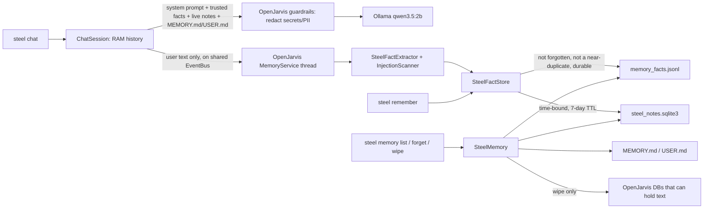
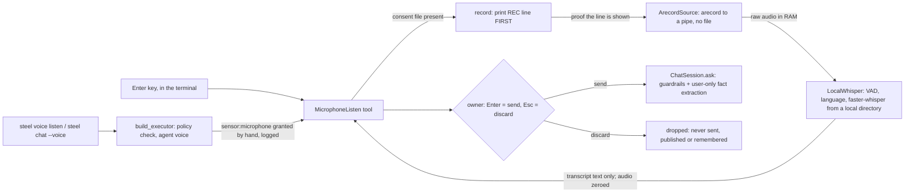

# Architecture

## Phases 1 and 1b: persistent memory, no tools

(Phase 2a added a permission policy, Phase 2b two read-only memory tools that only `steel tool call` runs, and Phase 2c push-to-talk voice input; see the sections after the memory notes below.)

| Module | Role |
| --- | --- |
| `steel/cli.py` | `steel` entry point. Checks the pin, sets `OPENJARVIS_NO_UPDATE_CHECK=1`, hardens permissions |
| `steel/pin.py` | Refuses any OpenJarvis other than `1.0.5.dev119+g108d257` (commit `108d257`) |
| `steel/home.py` | Resolves the OpenJarvis home; dir 700, files 600, umask 077 |
| `steel/chat.py` | Direct `engine.generate` calls with no agent and no tools; starts a `MemoryService` on `SteelFactStore` |
| `steel/extractor.py` | `SteelFactExtractor`: sends only the user's message with a stricter prompt; drops answer-like results |
| `steel/similarity.py` | Near-duplicate and related-fact matching (word overlap, English and Spanish, thresholds in one place) |
| `steel/timewords.py` | English and Spanish short-term time expressions |
| `steel/facts.py` | `SteelFactStore(LocalFactStore)`: stable id, `forget(id)`, hash-only forgotten list, duplicate guard, routing of time-bound facts to notes |
| `steel/memory_files.py` | Exact-line ids and removal for `MEMORY.md` / `USER.md` |
| `steel/memory.py` | `SteelMemory`: list (with expiry), remember, forget (with related), wipe and audit across all stores; `readable(source)`, the read-only view the tools use |
| `steel/notes.py`, `steel/notes_cli.py` | The original expiring SQLite notes (`read_unexpired` opens the file read-only and deletes nothing, for the tools); hold time-bound facts and `remember --days`; each note has a `source` (`user`, `time_bound`, `room`; nothing writes `room` yet); older databases are migrated to `user` |

### Phases 2a and 2b: permission policy and the first tools (command line only)

The chat does not enter this flow: the model cannot call a tool. Only `steel tool call` does. `steel policy show`, `steel tool list` and `steel doctor` read the grants file and write nothing.

| Module | Role |
| --- | --- |
| `steel/security/policy.py` | `SteelPolicy`: deny by default, fixed capability vocabulary, grants per agent, traversal-safe path matching, one grantable wildcard (`memory:read:*`), sensors never wildcarded. Adapted from OpenJarvis `capabilities.py` (see docs/PROVENANCE.md). No OpenJarvis import |
| `steel/security/audit.py` | Names-only decision log, mode 600, rotated at 5 MB (3 files kept); `write()` has no parameter for resources or text |
| `steel/security/executor.py` | `build_executor`: the only place STEEL builds a `ToolExecutor`. Refuses a missing policy, tools without declared capabilities, and file tools without declared path arguments |
| `steel/tools/memory_search.py`, `steel/tools/__init__.py` | `memory_search_facts` and `memory_search_notes` (one capability each, read only) and `get_memory_tools(home)`, the only function that builds them. Nothing is registered with OpenJarvis |
| `docs/POLICY.md` | The design, the exact `ToolExecutor` interface, every rule, every limit, and the test for each rule |

### Phase 2c: push-to-talk voice (command line only)

The transcript is treated exactly like typed text from the moment the owner confirms it; before that it only exists in the terminal and in the tool result. `steel voice check` is read-only and builds none of this.

| Module | Role |
| --- | --- |
| `steel/voice/consent.py` | The consent text and the consent file (a timestamp, mode 600, deletable). No file means no microphone |
| `steel/voice/indicator.py` | The `● REC` line and `IndicatorShown`, the proof the line was printed; only `Indicator.show` can make one |
| `steel/voice/recorder.py` | `record()`: the only caller of `AudioSource.open`. Prints the line, opens, reads ~100 ms chunks, stops at Enter, the maximum length, the silence cut-off or a cancel, always closes |
| `steel/voice/source.py`, `steel/voice/mic.py` | The `AudioSource` interface; the real source runs `arecord` into a pipe (needs the proof to open, hard `-d` limit, no file). Never imports `sounddevice` |
| `steel/voice/terminal.py` | Enter to start, Enter to stop, Enter/Esc to confirm, on a real terminal; type-ahead is flushed |
| `steel/voice/stt.py` | `LocalWhisper`: `faster-whisper` on the CPU from a model directory with `local_files_only`, audio as a NumPy array, Silero VAD before the model, restricted language detection. Imports neither `openjarvis.speech` nor any cloud code |
| `steel/voice/config.py` | `STEEL_VOICE_*` settings, validated, with safe fallbacks |
| `steel/voice/commands.py`, `steel/voice/speak.py` | `steel voice check/consent/revoke/listen`, the `chat --voice` loop, optional `espeak-ng` replies |
| `steel/tools/microphone.py` | `microphone_listen`: one capability (`sensor:microphone`), no arguments, transcript text only, audio wiped in a `finally`; `get_microphone_tool` in `steel/tools/__init__.py` builds it |
| `scripts/voice_check.py` | The owner's live check; scratch directory, deleted afterwards |
| `docs/VOICE.md` | The design (written first), the measurements, the consent text and the test for each claim |

### Relationship to OpenJarvis

STEEL imports OpenJarvis from the pinned install and never edits or copies its source. It uses the shared `core` objects (config, `EventBus`, `Message`/`Role`, registries), so anything STEEL registers later lands in the same registries OpenJarvis uses. It reuses `MemoryService`, `FactExtractor`, `InjectionScanner`, `inject_context`, `setup_security` and `get_engine` as they are.

STEEL constructs `MemoryService` itself instead of calling `build_memory_service`, because that helper would create a plain `LocalFactStore` (no forget-by-id, duplicate guard or routing) and OpenJarvis' `FactExtractor`. `SteelFactExtractor` subclasses it and uses only its public `extract` and `system_prompt`. `SteelFactStore.forget` holds the same thread lock and cross-process file lock as upstream `add`/`clear`, and uses LocalFactStore private members. That is why the pin is enforced at runtime.

The routing hook sits in `SteelFactStore.add` because every OpenJarvis path (`add_with_trust`, `add_many*`) ends there, so no OpenJarvis code is edited. Quarantined (untrusted) facts bypass the duplicate guard and are never routed to notes, which carry no trust marker.

### Fact ids

A fact's id is `f-` plus the first 12 hex characters of SHA-256 of its lowercased, stripped text. Upstream already dedupes facts case-insensitively, so the id is unique within the store and stable across restarts without changing the JSONL format. MEMORY.md/USER.md ids hash the exact line. Note ids are `n-` plus the note's UUID.

### What is not here

- No agent loop and nothing registered with OpenJarvis (`[tools] enabled = []`). `build_executor` is called by `steel tool call` and by tests only. The chat model cannot call a tool. The `memory_manage` tool is deliberately not used.
- No sandbox: the policy guards `ToolExecutor` calls only.
- No network server, no vision input, no wake word and no always-on listening. Voice input is push-to-talk only (below).
- Conversation history is not persisted.

## Planned extension points

`SteelPolicy`, the first tools and push-to-talk voice (Phases 2a to 2c) are built and tested; connecting a tool to the chat model is not done. Vision may later publish events on the same OpenJarvis `EventBus`; voice publishes none. The room-observation store will build on the expiring notes. These are plans, not implemented boundaries.
