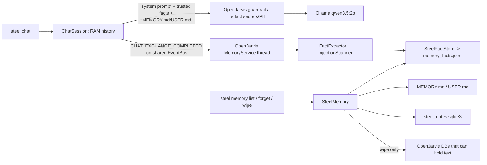

# Architecture

## Phase 1: persistent memory, no tools

| Module | Role |
| --- | --- |
| `steel/cli.py` | `steel` entry point. Checks the pin, sets `OPENJARVIS_NO_UPDATE_CHECK=1`, hardens permissions |
| `steel/pin.py` | Refuses any OpenJarvis other than `1.0.5.dev119+g108d257` (commit `108d257`) |
| `steel/home.py` | Resolves the OpenJarvis home; dir 700, files 600, umask 077 |
| `steel/chat.py` | Direct `engine.generate` calls with no agent and no tools; starts a `MemoryService` on `SteelFactStore` |
| `steel/facts.py` | `SteelFactStore(LocalFactStore)`: stable id, `forget(id)`, hash-only forgotten list |
| `steel/memory_files.py` | Exact-line ids and removal for `MEMORY.md` / `USER.md` |
| `steel/memory.py` | `SteelMemory`: list, forget, wipe and audit across all stores |
| `steel/notes.py`, `steel/notes_cli.py` | The original expiring SQLite notes, unchanged; future room-observation store |

### Relationship to OpenJarvis

STEEL imports OpenJarvis from the pinned install and never edits or copies its source. It uses the shared `core` objects (config, `EventBus`, `Message`/`Role`, registries), so anything STEEL registers later lands in the same registries OpenJarvis uses. It reuses `MemoryService`, `FactExtractor`, `InjectionScanner`, `inject_context`, `setup_security` and `get_engine` as they are.

STEEL constructs `MemoryService` itself instead of calling `build_memory_service`, because that helper would create a plain `LocalFactStore` without forget-by-id. `SteelFactStore.forget` holds the same thread lock and cross-process file lock as upstream `add`/`clear`, and uses LocalFactStore private members. That is why the pin is enforced at runtime.

### Fact ids

A fact's id is `f-` plus the first 12 hex characters of SHA-256 of its lowercased, stripped text. Upstream already dedupes facts case-insensitively, so the id is unique within the store and stable across restarts without changing the JSONL format. MEMORY.md/USER.md ids hash the exact line. Note ids are `n-` plus the note's UUID.

### What is not here

- No agent loop, no `ToolExecutor`, no registered tools (`[tools] enabled = []`). The `memory_manage` tool is deliberately not used.
- No network server, no voice or vision input.
- Conversation history is not persisted.

## Planned extension points

Phase 2 adds `SteelPolicy`, a permission policy every tool call must pass, before any tool is registered. Voice and vision may later publish events on the same OpenJarvis `EventBus`. The room-observation store will build on the expiring notes. These are plans, not implemented boundaries.
