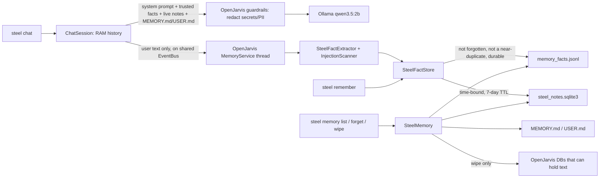
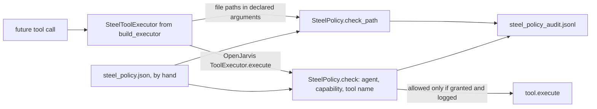

# Architecture

## Phases 1 and 1b: persistent memory, no tools

(Phase 2a added a permission policy that nothing uses yet; see the section after the memory notes below.)

| Module | Role |
| --- | --- |
| `steel/cli.py` | `steel` entry point. Checks the pin, sets `OPENJARVIS_NO_UPDATE_CHECK=1`, hardens permissions |
| `steel/pin.py` | Refuses any OpenJarvis other than `1.0.5.dev119+g108d257` (commit `108d257`) |
| `steel/home.py` | Resolves the OpenJarvis home; dir 700, files 600, umask 077 |
| `steel/chat.py` | Direct `engine.generate` calls with no agent and no tools; starts a `MemoryService` on `SteelFactStore` |
| `steel/extractor.py` | `SteelFactExtractor`: sends only the user's message with a stricter prompt; drops answer-like results |
| `steel/similarity.py` | Near-duplicate and related-fact matching (word overlap, English and Spanish, thresholds in one place) |
| `steel/timewords.py` | English and Spanish short-term time expressions |
| `steel/facts.py` | `SteelFactStore(LocalFactStore)`: stable id, `forget(id)`, hash-only forgotten list, duplicate guard, routing of time-bound facts to notes |
| `steel/memory_files.py` | Exact-line ids and removal for `MEMORY.md` / `USER.md` |
| `steel/memory.py` | `SteelMemory`: list (with expiry), remember, forget (with related), wipe and audit across all stores |
| `steel/notes.py`, `steel/notes_cli.py` | The original expiring SQLite notes (one read-only accessor added); hold time-bound facts and `remember --days`; each note has a `source` (`user`, `time_bound`, `room`; nothing writes `room` yet); older databases are migrated to `user` |

### Phase 2a: permission policy (not connected to anything)

No tool exists, so nothing enters this flow today. `steel policy show` and `steel doctor` read the grants file; neither writes the log.

| Module | Role |
| --- | --- |
| `steel/security/policy.py` | `SteelPolicy`: deny by default, fixed capability vocabulary, grants per agent, traversal-safe path matching, sensors never wildcarded. Adapted from OpenJarvis `capabilities.py` (see docs/PROVENANCE.md). No OpenJarvis import |
| `steel/security/audit.py` | Names-only decision log, mode 600; `write()` has no parameter for resources or text |
| `steel/security/executor.py` | `build_executor`: the only place STEEL builds a `ToolExecutor`. Refuses a missing policy, tools without declared capabilities, and file tools without declared path arguments |
| `docs/POLICY.md` | The design, the exact `ToolExecutor` interface, every rule, every limit, and the test for each rule |

### Relationship to OpenJarvis

STEEL imports OpenJarvis from the pinned install and never edits or copies its source. It uses the shared `core` objects (config, `EventBus`, `Message`/`Role`, registries), so anything STEEL registers later lands in the same registries OpenJarvis uses. It reuses `MemoryService`, `FactExtractor`, `InjectionScanner`, `inject_context`, `setup_security` and `get_engine` as they are.

STEEL constructs `MemoryService` itself instead of calling `build_memory_service`, because that helper would create a plain `LocalFactStore` (no forget-by-id, duplicate guard or routing) and OpenJarvis' `FactExtractor`. `SteelFactExtractor` subclasses it and uses only its public `extract` and `system_prompt`. `SteelFactStore.forget` holds the same thread lock and cross-process file lock as upstream `add`/`clear`, and uses LocalFactStore private members. That is why the pin is enforced at runtime.

The routing hook sits in `SteelFactStore.add` because every OpenJarvis path (`add_with_trust`, `add_many*`) ends there, so no OpenJarvis code is edited. Quarantined (untrusted) facts bypass the duplicate guard and are never routed to notes, which carry no trust marker.

### Fact ids

A fact's id is `f-` plus the first 12 hex characters of SHA-256 of its lowercased, stripped text. Upstream already dedupes facts case-insensitively, so the id is unique within the store and stable across restarts without changing the JSONL format. MEMORY.md/USER.md ids hash the exact line. Note ids are `n-` plus the note's UUID.

### What is not here

- No agent loop and no registered tools (`[tools] enabled = []`). `build_executor` exists but is called only by tests. The `memory_manage` tool is deliberately not used.
- No sandbox: the policy guards `ToolExecutor` calls only.
- No network server, no voice or vision input.
- Conversation history is not persisted.

## Planned extension points

`SteelPolicy` (Phase 2a) is built and tested; the first tool will be the first user of it. Voice and vision may later publish events on the same OpenJarvis `EventBus`. The room-observation store will build on the expiring notes. These are plans, not implemented boundaries.
