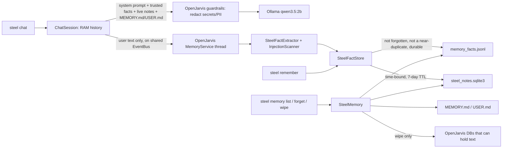
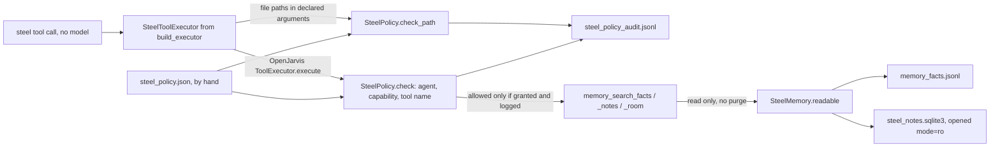
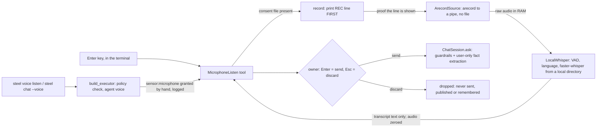
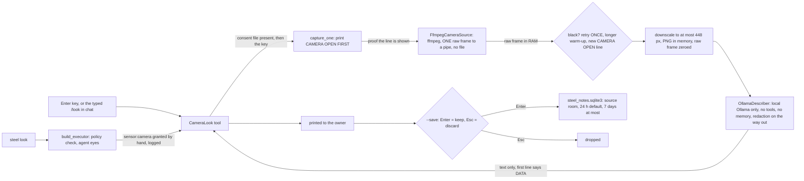
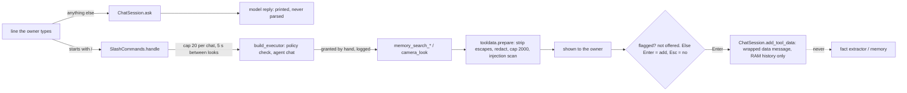
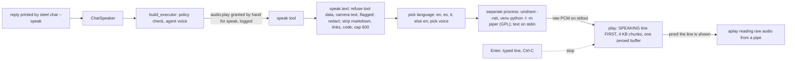

# Architecture

## Phases 1 and 1b: persistent memory, no tools

(Phase 2a added a permission policy, Phase 2b read-only memory tools, Phase 2c push-to-talk voice input, Phase 3 one-picture camera snapshots and Phase 4 slash commands that the owner types in `steel chat`; see the sections after the memory notes below. The model still has no tools.)

| Module | Role |
| --- | --- |
| `steel/cli.py` | `steel` entry point. Checks the pin, sets `OPENJARVIS_NO_UPDATE_CHECK=1`, hardens permissions |
| `steel/pin.py` | Refuses any OpenJarvis other than `1.0.5.dev119+g108d257` (commit `108d257`) |
| `steel/home.py` | Resolves the OpenJarvis home; dir 700, files 600, umask 077 |
| `steel/chat.py` | Direct `engine.generate` calls with no agent and no tools for the model; starts a `MemoryService` on `SteelFactStore`; `add_tool_data` puts a result the owner chose into the RAM history only (Phase 4) |
| `steel/extractor.py` | `SteelFactExtractor`: sends only the user's message with a stricter prompt; drops answer-like results; skips any text holding a wrapped tool result |
| `steel/similarity.py` | Near-duplicate and related-fact matching (word overlap, English and Spanish, thresholds in one place) |
| `steel/timewords.py` | English and Spanish short-term time expressions |
| `steel/facts.py` | `SteelFactStore(LocalFactStore)`: stable id, `forget(id)`, hash-only forgotten list, duplicate guard, routing of time-bound facts to notes |
| `steel/memory_files.py` | Exact-line ids and removal for `MEMORY.md` / `USER.md` |
| `steel/memory.py` | `SteelMemory`: list (with expiry), remember, forget (with related), wipe and audit across all stores; `readable(source)`, the read-only view the tools use |
| `steel/notes.py`, `steel/notes_cli.py` | The original expiring SQLite notes (`read_unexpired` opens the file read-only and deletes nothing, for the tools); hold time-bound facts and `remember --days`; each note has a `source` (`user`, `time_bound`, `room`; only `steel look --save` writes `room`); older databases are migrated to `user`, and `read_unexpired` filters by source |

### Phases 2a and 2b: permission policy and the first tools (command line only)

The model never enters this flow: it cannot call a tool. `steel tool call` does, and since Phase 4 so do the owner's typed slash commands in `steel chat` (next sections). `steel policy show`, `steel tool list` and `steel doctor` read the grants file and write nothing.

| Module | Role |
| --- | --- |
| `steel/security/policy.py` | `SteelPolicy`: deny by default, fixed capability vocabulary, grants per agent, traversal-safe path matching, one grantable wildcard (`memory:read:*`), sensors never wildcarded. Adapted from OpenJarvis `capabilities.py` (see docs/PROVENANCE.md). No OpenJarvis import |
| `steel/security/audit.py` | Names-only decision log, mode 600, rotated at 5 MB (3 files kept); `write()` has no parameter for resources or text |
| `steel/security/executor.py` | `build_executor`: the only place STEEL builds a `ToolExecutor`. Refuses a missing policy, tools without declared capabilities, and file tools without declared path arguments |
| `steel/tools/memory_search.py`, `steel/tools/__init__.py` | `memory_search_facts`, `memory_search_notes` and `memory_search_room` (one capability each, read only; room notes only through `memory:read:room`) and `get_memory_tools(home)`, the only function that builds them. Nothing is registered with OpenJarvis |
| `docs/POLICY.md` | The design, the exact `ToolExecutor` interface, every rule, every limit, and the test for each rule |

### Phase 2c: push-to-talk voice (command line only)

The transcript is treated exactly like typed text from the moment the owner confirms it; before that it only exists in the terminal and in the tool result. `steel voice check` is read-only and builds none of this.

| Module | Role |
| --- | --- |
| `steel/voice/consent.py` | The consent text and the consent file (a timestamp, mode 600, deletable). No file means no microphone |
| `steel/voice/indicator.py` | The `● REC` line and `IndicatorShown`, the proof the line was printed; only `Indicator.show` can make one |
| `steel/voice/recorder.py` | `record()`: the only caller of `AudioSource.open`. Prints the line, opens, reads ~100 ms chunks, stops at Enter, the maximum length, the silence cut-off or a cancel, always closes |
| `steel/voice/source.py`, `steel/voice/mic.py` | The `AudioSource` interface; the real source runs `arecord` into a pipe (needs the proof to open, hard `-d` limit, no file). Never imports `sounddevice` |
| `steel/voice/terminal.py` | Enter to start, Enter to stop, Enter/Esc to confirm, on a real terminal; type-ahead is flushed |
| `steel/voice/stt.py` | `LocalWhisper`: `faster-whisper` on the CPU from a model directory with `local_files_only`, audio as a NumPy array, Silero VAD before the model, restricted language detection. Imports neither `openjarvis.speech` nor any cloud code |
| `steel/voice/config.py` | `STEEL_VOICE_*` settings, validated, with safe fallbacks |
| `steel/voice/commands.py` | `steel voice check/consent/revoke/listen`, the `chat --voice` loop (spoken replies: Phase 5a below) |
| `steel/tools/microphone.py` | `microphone_listen`: one capability (`sensor:microphone`), no arguments, transcript text only, audio wiped in a `finally`; `get_microphone_tool` in `steel/tools/__init__.py` builds it |
| `scripts/voice_check.py` | The owner's live check; scratch directory, deleted afterwards |
| `docs/VOICE.md` | The design (written first), the measurements, the consent text and the test for each claim |

### Phase 3: one camera snapshot (command line only)

The description is untrusted data from the moment it exists: it starts with a fixed line saying so, a scanner flags instruction-like text, saved notes keep the line and are listed apart in the chat prompt. `steel vision check` is read-only and builds none of this.

| Module | Role |
| --- | --- |
| `steel/consent.py` | The consent-file checks (regular file, ours, not writable by others, one timestamp), shared by the microphone and the camera, each with its own file |
| `steel/vision/consent.py` | The camera consent text and file. No file means no camera |
| `steel/vision/indicator.py` | The `● CAMERA OPEN` line and `CameraShown`, the proof the line was printed; only `CameraIndicator.show` can make one |
| `steel/vision/capture.py` | `capture_one()`: the only caller of `FrameSource.open` for the camera. Prints the line, opens, reads ONE frame, always closes |
| `steel/vision/source.py`, `steel/vision/camera.py` | The `FrameSource` interface; the real source runs `ffmpeg` and writes one raw frame to a pipe (needs the proof to open, watchdog, no file) |
| `steel/vision/frame.py` | `Frame`, area-average downscale with NumPy, a PNG encoder from the standard library, wiping. No imaging library |
| `steel/vision/describe.py` | The fixed system prompt, the "data" line, `OllamaDescriber` (loopback hosts only, `OllamaEngine` + OpenJarvis redaction scanners), text cleaning |
| `steel/vision/config.py`, `steel/vision/commands.py` | `STEEL_CAMERA_DEVICE` / `STEEL_VISION_MODEL` (default `qwen3.5:2b`) / `STEEL_CAMERA_WARMUP_FRAMES` (default 20); `steel vision check/consent/revoke` and `steel look [--save]` |
| `steel/vision/startkey.py` | `PictureKey`: the Enter key that takes the picture (the voice `Terminal` with the camera's words); `arm()` when the typed `/look` is the key press |
| `steel/tools/camera.py` | `camera_look`: one capability (`sensor:camera`), one optional `question`, text only, frame wiped in a `finally`; `get_camera_tool` in `steel/tools/__init__.py` builds it |
| `scripts/vision_check.py` | The owner's live check; scratch directory, deleted afterwards |
| `docs/VISION.md` | The design (written first), the measurements, the consent text and the test for each claim |

### Phase 4: slash commands in `steel chat` (typed by the owner; the model has no tools)

| Module | Role |
| --- | --- |
| `steel/slash.py` | The commands (`/search`, `/notes`, `/room`, `/look`, `/help`), the limits, the banner (policy preview, not logged), `build_slash` (one executor as agent `chat`) |
| `steel/tooldata.py` | `prepare` (rule 1 of docs/INJECTION.md), the wrapper, `is_tool_data` for the extractor |
| `steel/meminfo.py` | `steel doctor`'s memory-pressure warning (reads `/proc/meminfo` only) |
| `docs/INJECTION.md` | The threat model and rules (written first), why model-initiated tool calls are not implemented, and the test for each rule |

### Phase 5a: spoken replies (opt-in, the owner's grant)

Nothing of Piper is imported into STEEL's process; the boundary is the pipe (docs/SPEAK.md section 4). A line typed to stop a reply is used as the next message. In voice chat a reply is spoken after the recording has ended, never during.

| Module | Role |
| --- | --- |
| `steel/speak/text.py`, `steel/speak/language.py`, `steel/speak/config.py` | What may be spoken and in what form; the language guess; `STEEL_SPEAK_MAX_CHARS` |
| `steel/speak/voices.py` | The pinned voices (revision, sizes, SHA-256); which installed voice reads a language |
| `steel/speak/synth.py` | Starting Piper as a separate program in a network namespace, text on stdin, minimal environment; no `unshare`, no engine |
| `steel/speak/indicator.py`, `steel/speak/player.py`, `steel/speak/playback.py`, `steel/speak/keys.py` | The `▶ SPEAKING` line and its proof; `aplay` on a pipe (opens only with the proof); the relay loop, the only opener of the speaker; Enter or a typed line to stop |
| `steel/speak/commands.py` | `steel speak check` (read only) and `say`, `ChatSpeaker` for the chat loops |
| `steel/tools/speak.py` | `speak`: one capability (`audio:play`), one `text` argument, a status without the text; `get_speak_tool` in `steel/tools/__init__.py` builds it |
| `steel/offline.py` | `ORT_DISABLE_TELEMETRY=1` for onnxruntime (also for faster-whisper since Phase 5a) |
| `scripts/speak_setup.py`, `scripts/piper-requirements.txt` | One-time setup: the engine from hash-pinned wheels, the voices checked against their SHA-256 |
| `scripts/speak_check.py` | The owner's live check through the real speakers; scratch grant |
| `docs/SPEAK.md` | The design (written first), measurements, licences, and the test for each claim |

### Relationship to OpenJarvis

STEEL imports OpenJarvis from the pinned install and never edits or copies its source. It uses the shared `core` objects (config, `EventBus`, `Message`/`Role`, registries), so anything STEEL registers later lands in the same registries OpenJarvis uses. It reuses `MemoryService`, `FactExtractor`, `InjectionScanner`, `inject_context`, `setup_security` and `get_engine` as they are (the chat path). The camera path imports only `OllamaEngine`, `Message`, `GuardrailsEngine` with the secret and PII scanners, and `InjectionScanner`; it does not call `get_engine`. The slash commands reuse `SecretScanner`, `PIIScanner` and `InjectionScanner` on tool results, and the stock `ToolExecutor` through `build_executor`.

STEEL constructs `MemoryService` itself instead of calling `build_memory_service`, because that helper would create a plain `LocalFactStore` (no forget-by-id, duplicate guard or routing) and OpenJarvis' `FactExtractor`. `SteelFactExtractor` subclasses it and uses only its public `extract` and `system_prompt`. `SteelFactStore.forget` holds the same thread lock and cross-process file lock as upstream `add`/`clear`, and uses LocalFactStore private members. That is why the pin is enforced at runtime.

The routing hook sits in `SteelFactStore.add` because every OpenJarvis path (`add_with_trust`, `add_many*`) ends there, so no OpenJarvis code is edited. Quarantined (untrusted) facts bypass the duplicate guard and are never routed to notes, which carry no trust marker.

### Fact ids

A fact's id is `f-` plus the first 12 hex characters of SHA-256 of its lowercased, stripped text. Upstream already dedupes facts case-insensitively, so the id is unique within the store and stable across restarts without changing the JSONL format. MEMORY.md/USER.md ids hash the exact line. Note ids are `n-` plus the note's UUID.

### What is not here

- No agent loop and nothing registered with OpenJarvis (`[tools] enabled = []`). `build_executor` is called by `steel tool call` and by tests only. The chat model cannot call a tool. The `memory_manage` tool is deliberately not used.
- No sandbox: the policy guards `ToolExecutor` calls only.
- No network server, no wake word, no always-on listening, no video, no motion detection and no recognising people. Voice input is push-to-talk and vision is one picture per command (above). Spoken replies have no echo cancellation; none is needed while the microphone is push-to-talk (docs/SPEAK.md section 7).
- Conversation history is not persisted.

## Planned extension points

`SteelPolicy`, the first tools, push-to-talk voice, camera snapshots (Phases 2a to 3), slash commands (Phase 4) and spoken replies (Phase 5a) are built and tested; connecting a tool to the chat model is not done. Voice and vision publish nothing on the OpenJarvis `EventBus`. These are plans, not implemented boundaries.
